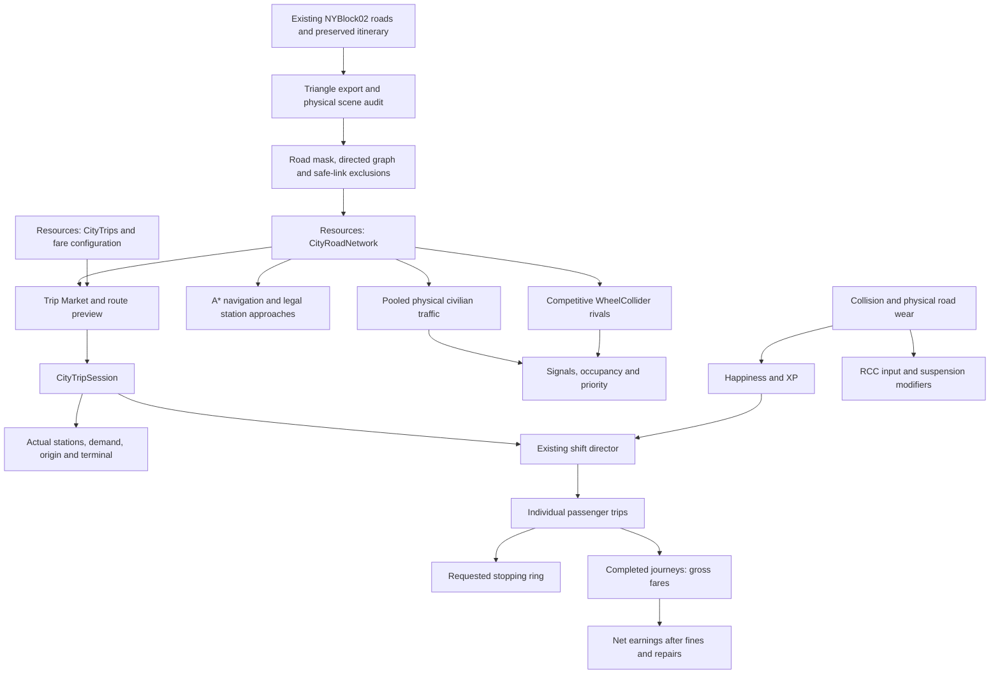
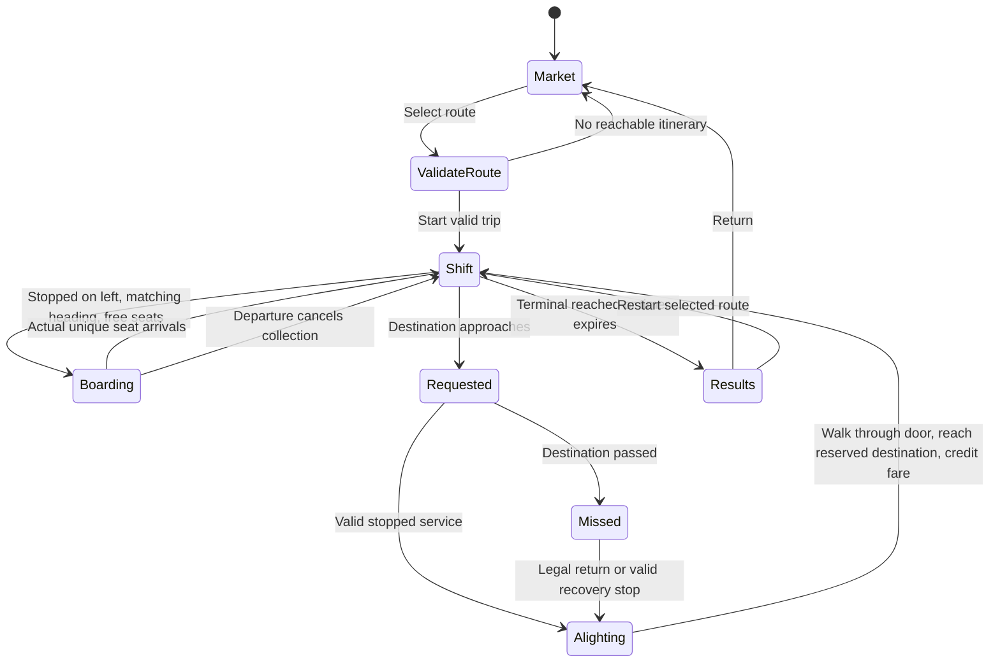
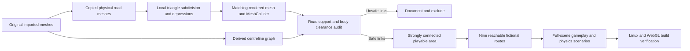
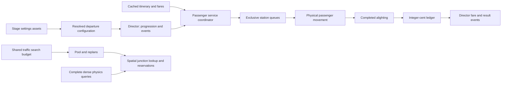

# City implementation diagrams

## Runtime data flow

## Trip and passenger flow

## Road authoring and validation gate

## 12 November source ownership

This describes the changed source. Fresh runtime verification is pending; historical passes do not validate the new composition.
