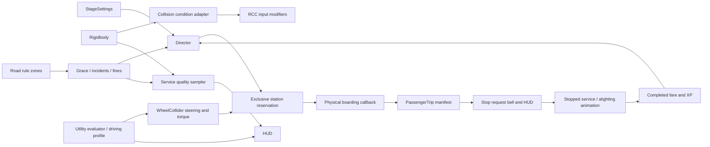
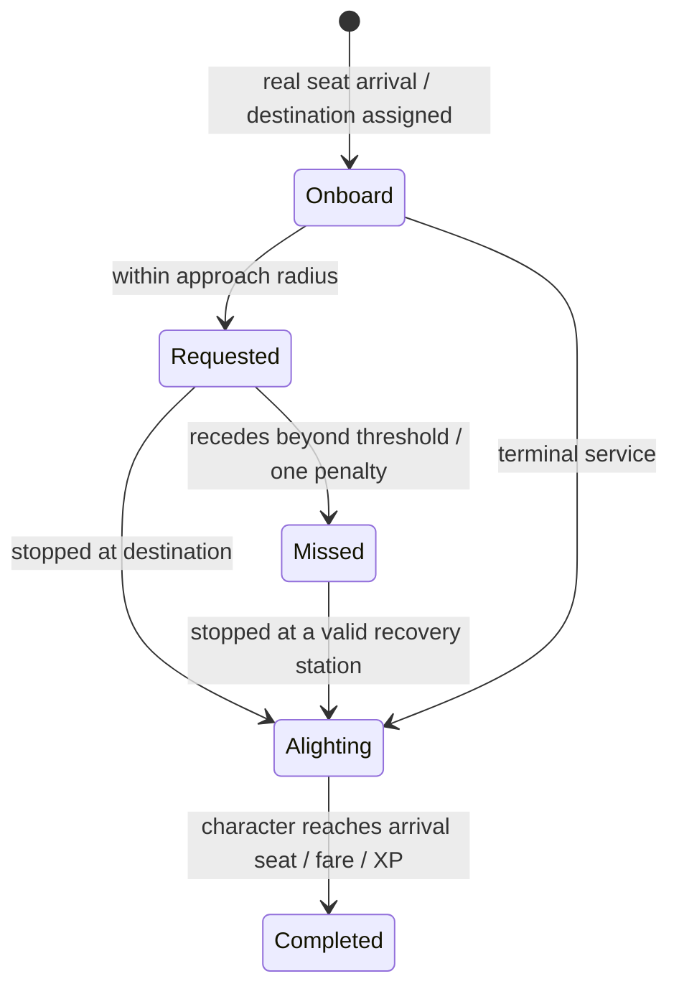
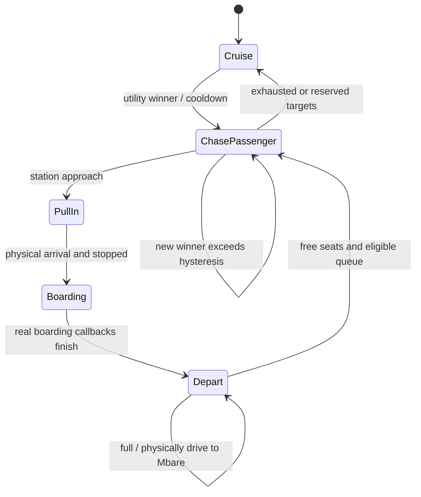
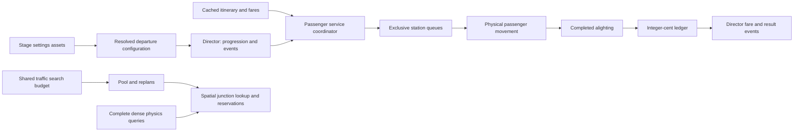

# Current system diagrams — 9 November expansion

Character states (Seated, Walking, Onboard, Returning, Alighting, Delivered) remain separate from trip service states. No event alone proves physical movement: integration checks observe the rigidbody and actual passenger transitions.

## 12 November source ownership

This describes the changed source. Fresh runtime verification is pending; historical passes do not validate the new composition.
