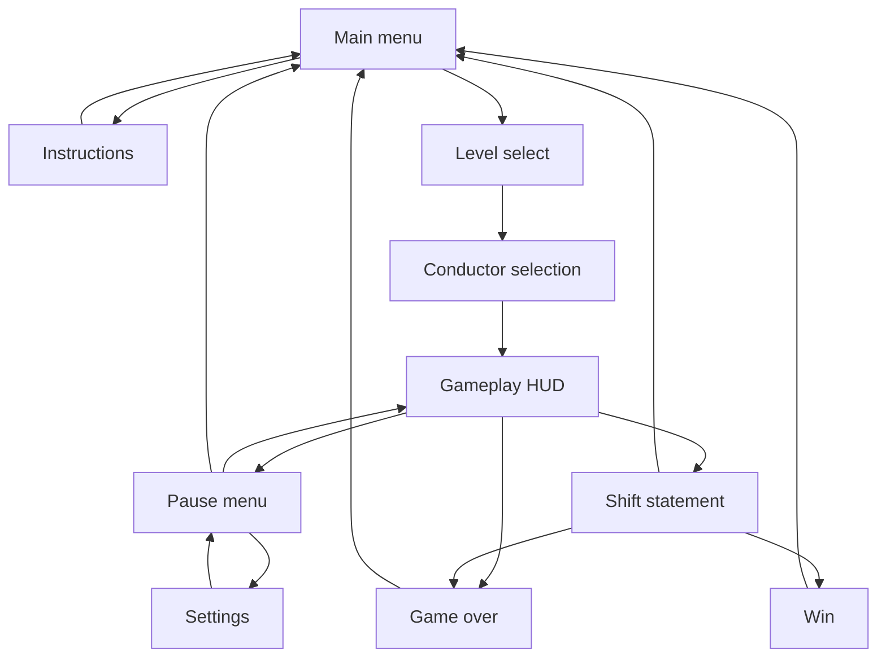

# Screen flow — integration draft
Owner: Tadiwa; integration draft prepared for review on 1 November 2026.

Level/conductor/instructions/settings are UI routes, not additional GameState values. The state remains Menu during pre-game selection and Paused during settings. Gameplay simulation must subscribe to state changes; pausing time alone does not disable Update input handlers. ShiftEnd/Win/GameOver must block gameplay commands explicitly.
