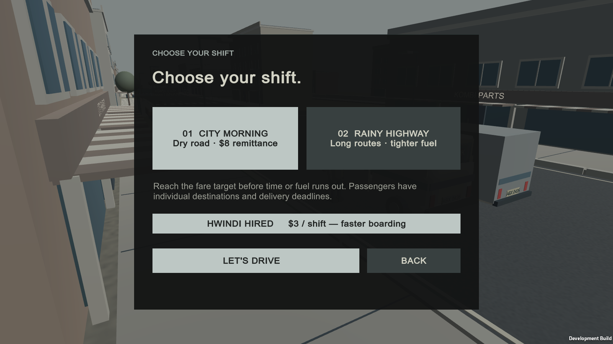
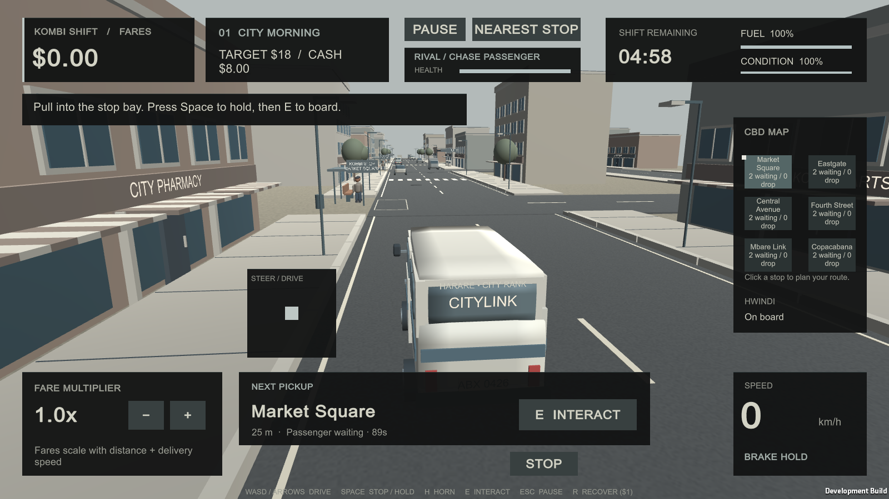

# Tendai — Rival AI and optimisation

## Scope and implementation

The sprint plan assigns Tendai waypoint traffic and pooling, the RivalAI state machine, Level/Hwindi selection, before/after profiling, and the report section and live state-change defence.

| Sprint deliverable | Project status |
|---|---|
| Sprint 0: waypoint prototype, state diagram and pooling foundation | Implemented in `RoadGraph.cs` and `SpawnManager.cs`; state diagram included below. |
| Sprint 1: pooled waypoint traffic and rival Cruise behavior | Implemented; traffic uses waypoint movement and shared pooling. |
| Sprint 2: full RivalAI, state label, level selection and baseline profiling | Implemented; level/Hwindi selection exists, HUD shows state/health, and fresh baseline counters/CSV/raw capture were recorded. |
| Sprint 3: traffic/pothole pooling, pooled profiling, Hwindi selection and Level 2 aggression | Implemented; fresh pooled counters/CSV/raw capture and runtime UI screenshots are saved. Native Profiler-window screenshots remain outstanding. |
| Sprint 4: AI/optimisation report and live state-change defence | Report and rehearsal steps are prepared. Tendai still needs to perform the live rehearsal and capture the requested Profiler-window screenshots. |

- `UnityStarter/Assets/KombiShiftJayden/Runtime/Systems/RoadGraph.cs` builds connected city/highway waypoint networks and finds routes.
- `UnityStarter/Assets/KombiShiftJayden/Runtime/Systems/SpawnManager.cs` preallocates and reuses traffic, passenger and pothole objects. Traffic stays pooled in both profiling modes so the passenger/hazard pooling comparison isolates allocation churn.
- `UnityStarter/Assets/KombiShiftJayden/Runtime/Systems/RivalAI.cs` implements Cruise, ChasePassenger, Block and Flee. The rival follows waypoints, pursues waiting passengers, attempts bounded blocks near the player, and flees when damaged or blocked. Its public debug label is shown with health in the driving HUD.
- `UnityStarter/Assets/KombiShiftJayden/Runtime/ShiftGame.UI.cs` provides city/highway and optional Hwindi selection, including the $3 shift cost and faster boarding benefit.
- `UnityStarter/Assets/KombiShiftJayden/Runtime/ShiftGame.Performance.cs` runs an identical 240-frame pedestrian/pothole churn fixture with pooling disabled and enabled, records Unity Profiler counters, and writes frame CSVs and a comparison JSON file. Use the `WindowsProfile` development build entry point for local Windows captures; release players do not support the Profiler.

## RivalAI state diagram

```text
CRUISE -- nearest waiting passenger --> CHASE PASSENGER
CRUISE or CHASE PASSENGER -- player within radius and block cooldown ready --> BLOCK
CHASE PASSENGER -- reaches passenger --> take passenger --> reevaluate target
BLOCK -- 1.2-second block expires --> reevaluate target
Any active state -- health below 30 or blocked longer than 1.4 seconds --> FLEE
FLEE -- route planned to farthest waypoint from player --> continue fleeing
```

Decisions are evaluated every 0.4 seconds. A block lasts 1.2 seconds and has an 8/aggression-second cooldown. On the rainy highway, aggression is 1.5, increasing the block radius and vehicle speed. When a block ends, the AI reevaluates whether to chase the nearest waiting passenger or cruise. `RivalAI.Current` drives the HUD's `RIVAL AI / <STATE>` debug label; the separate health meter makes damage-triggered retreat visible.

## Optimisation evidence

Saved controlled run: Unity 6000.6.2f1; 240 samples per mode after warm-up; fixed 60 Hz simulation; nine traffic vehicles, twelve pedestrians and six hazards; one pedestrian and one pothole recycled each frame. This is an automated churn fixture, not a human-driven benchmark or general FPS claim.

| Metric | Baseline | Pooled | Change |
|---|---:|---:|---:|
| Mean GC allocated / frame | 14,160.73 B | 13,585.64 B | 4.1% lower |
| Mean main-thread time | 21.08 ms | 20.63 ms | 2.1% lower |
| Mean wall frame time | 21.27 ms | 20.77 ms | 2.4% lower |
| 95th-percentile wall frame time | 23.48 ms | 23.18 ms | 1.3% lower |
| Samples | 240 | 240 | — |

This fresh Windows 11 development-player capture ran on Intel UHD Graphics 620 with Unity 6000.6.2f1. The shared fixture holds the same route, traffic density, passenger/hazard count and recycle rate for both passes; Profiler counters were valid in both. The pooling run reduced measured GC allocation modestly. The small timing differences are one automated run and do not establish a general frame-rate improvement.

Evidence in this project copy:

- `UnityStarter/Validation/comparison.json` — run metadata and summary.
- `UnityStarter/Validation/baseline-frames.csv` and `UnityStarter/Validation/pooled-frames.csv` — frame-level measurements.
- `UnityStarter/Validation/TendaiEvidence/ProfilerCaptures/baseline.raw` and `pooled.raw` — native Unity Profiler captures (about 27.6 MB and 26.0 MB).
- `UnityStarter/Validation/TendaiEvidence/level-hwindi-selection.png` and `city.png` — runtime evidence for the level/Hwindi selector and RivalAI HUD label; the folder also contains menu, rain and hwindi service screenshots.
- `UnityStarter/Validation/concept-results.json` — final Windows development-player regression (41 passed, 0 failed).
- `UnityStarter/Validation/RESULTS.md` — test scope and limitations.
- `UnityStarter/Assets/KombiShiftJayden/Runtime/ShiftGame.Performance.cs` — reproducible capture routine (`--kombi-profile`).
- `UnityStarter/Assets/KombiShiftJayden/Editor/StarterBuild.cs` — `WindowsProfile` development build entry point.

**Submission gap:** The raw captures and CSV/JSON are now saved, and runtime game screenshots are available. Unity Profiler-window screenshots showing the baseline and pooled Memory/GC Allocated In Frame and Main Thread counters have not been captured; Tendai should open each `.raw` file in the pinned Editor's Profiler and save those two screenshots.

### Runtime screenshots

These are screenshots of the running game, not screenshots of the Unity Profiler window.





Additional menu, rainy-highway and hwindi boarding/alighting screenshots are in `UnityStarter/Validation/TendaiEvidence/`.

## User-provided gameplay reference

The supplied 10-second gameplay clip is a reference for the playable walkthrough, not for Profiler captures. It demonstrates the CBD shift HUD, accelerating along the road, approaching the Market Square stop, braking to a hold, interacting with the passenger, and checking the rival-state display. Use this sequence for a manual acceptance check:

1. Start a CBD shift and verify the fare, cash, clock, fuel, condition, passenger map and RivalAI state/health are visible.
2. Accelerate with **W** toward Market Square and slow before the marked stop.
3. Hold **Space** until the kombi is stationary in the stop area; use **E** to board.
4. Confirm the boarding progress/hwindi response appears, then drive to the passenger destination and deliver before patience expires.
5. Confirm the fare payout and that the RivalAI state label updates while gameplay continues.

The clip shows a projected stop arrow. This project intentionally keeps map/stop markers without a guidance arrow, as documented in the existing design choice; use the Market Square map/stop marker to navigate. The fresh automated regression verifies pickup bounds, passenger boarding/delivery and RivalAI states, but does not replace a human's recorded end-to-end playthrough.

## Regression evidence

`UnityStarter/Validation/concept-results.json` records 41 passed and 0 failed in a fresh native Windows development-player run, including pooled reuse and RivalAI chase, flee and block behavior plus the Cruise, Chase Passenger, Flee and Block labels. These automated checks are not a substitute for human playtesting.

## Defence rehearsal

1. Start a CBD shift and point out the HUD's rival state label and health meter.
2. In `RivalAI.Configure`, change the relevant aggression value or adjust a state decision threshold, then run the scene and explain the visible behavior change.
3. Demonstrate Cruise -> ChasePassenger by placing a waiting passenger on a reachable stop; demonstrate Flee by applying enough damage; demonstrate Block by moving the player within the rival's block radius.
4. Open the saved `baseline.raw` and `pooled.raw` captures in Unity Profiler, save counter screenshots, then explain the measured 4.1% GC-allocation reduction and why one fixed-timestep churn-fixture run does not prove a general FPS improvement.

The implementation and this report were prepared with AI assistance. Tendai must review, understand, and perform the live rehearsal before presenting the work as their own.
